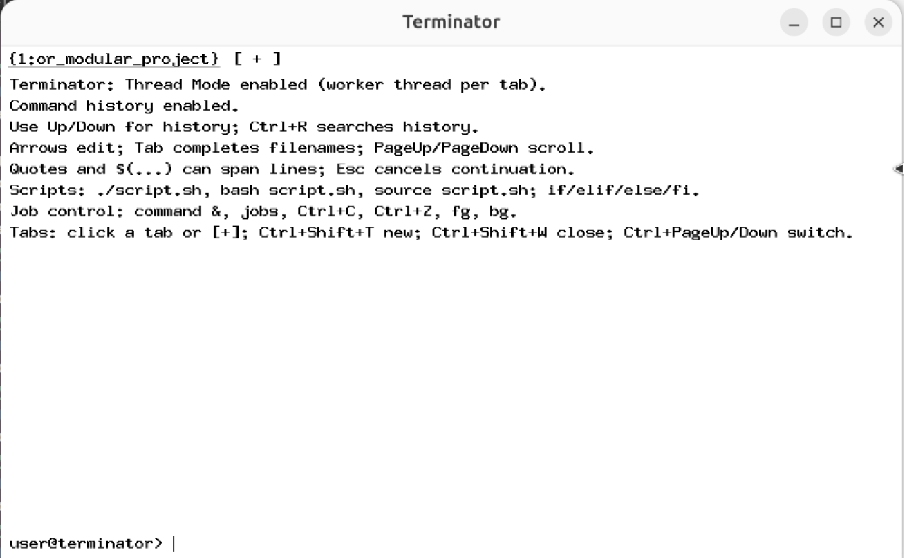
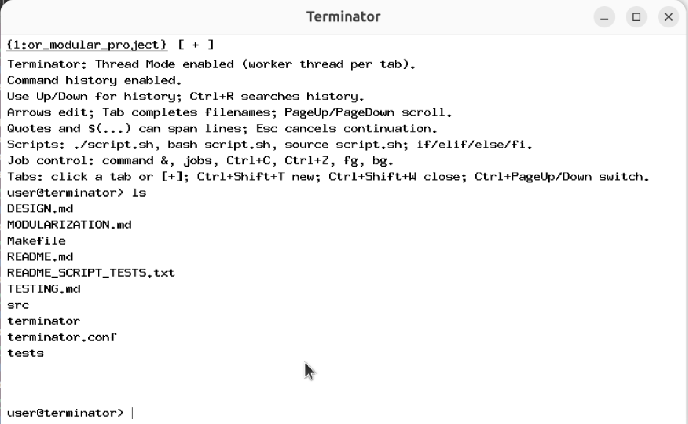
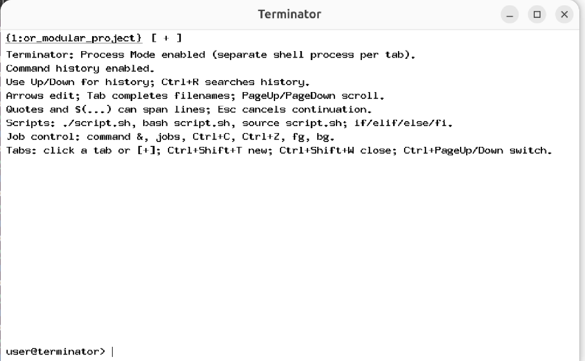
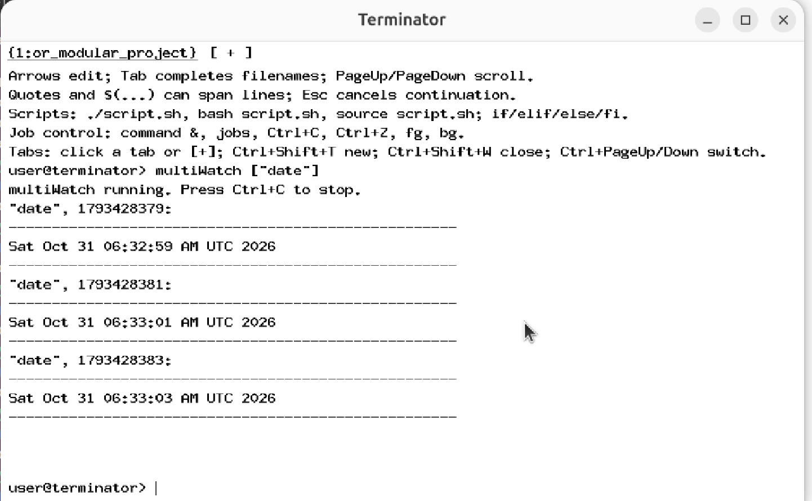

# Terminator — Custom X11 Terminal Emulator

A lightweight graphical terminal emulator and custom shell prototype for Linux, developed in **C using Xlib and POSIX system APIs**.

Terminator provides an X11-based terminal interface with multiple tabs, command execution, shell-like functionality, job control, persistent command history, filename autocomplete, and two execution architectures: **Thread Mode** and **Process Mode**.

The project focuses on operating-system concepts such as process creation, inter-process communication, multithreading, synchronization, pipes, signals, and file descriptor management.

---

## Screenshots

## Terminal Interface & Thread Mode

<p align="center">
  
  
</p>

## Process Mode & MultiWatch

<p align="center">
  
  
</p>

---

## Features

### Graphical Terminal Interface

- X11-based graphical terminal window using Xlib.
- Multiple terminal tabs.
- Independent working directories for individual tabs.
- Keyboard-driven command input and terminal interaction.
- Text selection and clipboard copy/paste support.
- Configurable keyboard shortcuts.

### Two Execution Modes

Terminator supports two different execution architectures.

**1. Thread Mode (Default)**

```bash
./terminator
```

- Runs the graphical interface and shell within one process.
- Each terminal tab has its own worker thread.
- Uses POSIX threads for concurrent command processing.
- Uses synchronization primitives to coordinate shared state and worker activity.

**2. Process Mode**

```bash
./terminator useProcess=True
```

- Runs the graphical interface in a parent process.
- Creates a separate child process for each terminal tab.
- Uses pipes for inter-process communication.
- Maintains shared command history using shared memory and process-shared synchronization.

| Property | Thread Mode | Process Mode |
|---|---|---|
| Execution model | Multiple threads | Multiple processes |
| Tab isolation | Worker threads | Separate child processes |
| Communication | Shared memory | Pipes / IPC |
| Synchronization | Mutexes and condition variables | Process-shared synchronization |
| GUI | Main process | Parent process |

### Shell Functionality

Terminator implements a subset of common shell functionality:

- External command execution using `fork()` and `execvp()`.
- Built-in commands such as `cd`, `exit`, `history`, `jobs`, `fg`, `bg`, and `source`.
- Exit status handling through `$?`.
- Command pipelines using `|`.
- Input redirection using `<`.
- Output redirection using `>`.
- Quoted arguments and escape handling.
- Variable expansion and command substitution.
- Multiline command continuation for incomplete expressions.

### Job Control and Signal Handling

- Foreground and background command execution.
- Background execution using `&`.
- Job listing using `jobs`.
- Job management using `fg` and `bg`.
- Foreground interruption using `Ctrl+C`.
- Foreground job suspension using `Ctrl+Z`.
- Process-group-based signal handling.

### MultiWatch

Terminator includes a custom `multiWatch` command for monitoring multiple commands concurrently.

Example:

```bash
multiWatch ["date +%T", "uname -a"]
```

The feature:

- Executes multiple commands concurrently.
- Collects their output.
- Displays formatted command output.
- Re-executes commands after completion at the configured interval.
- Supports interruption using `Ctrl+C`.

### Command History

- Persistent command history.
- History stored in `~/.terminator_history`.
- History navigation using the Up and Down arrow keys.
- History display through the `history` command.
- Reverse search using `Ctrl+R`.
- Shared history across tabs.

### Filename Autocomplete

- Filename and path completion using the `Tab` key.
- Automatic completion when a unique match is available.
- Common-prefix completion when multiple matches exist.
- Selection of available matches.

### Keyboard Editing and Clipboard

The terminal provides interactive input editing and clipboard functionality.

| Shortcut | Action |
|---|---|
| `Ctrl + A` | Move cursor to the beginning of input |
| `Ctrl + E` | Move cursor to the end of input |
| `Ctrl + U` | Clear input before cursor |
| `Ctrl + K` | Clear input after cursor |
| `Ctrl + W` | Delete the previous word |
| `Ctrl + L` | Clear terminal display |
| `Ctrl + R` | Search command history |
| `Ctrl + Shift + C` | Copy selected text |
| `Ctrl + Shift + V` | Paste clipboard text |
| `Shift + Insert` | Paste clipboard text |
| `Middle Mouse Click` | Paste primary selection |

Tab-related keyboard shortcuts can be configured through `terminator.conf`.

### Custom Shell Script Interpreter

Terminator includes a C-based interpreter for a supported subset of shell scripting.

Supported functionality includes:

- Variable assignments.
- Variable expansion.
- Positional parameters such as `$1`, `$2`, and `$#`.
- Exit status handling through `$?`.
- Conditional statements: `if`, `elif`, `else`, and `fi`.
- Nested conditional statements.
- Numeric and string comparisons.
- File and directory tests.
- Script exit handling.

Example:

```bash
NAME=World

if [ "$NAME" = "World" ]; then
    echo "Hello World"
else
    echo "Hello User"
fi
```

The interpreter validates conditional structure before executing a script.

**Note:** This is a limited shell-script interpreter, not a complete implementation of Bash. Features such as loops and user-defined shell functions are outside the implemented scope.

---

## Technology Stack

| Component | Technology |
|---|---|
| Programming Language | C |
| GUI | Xlib / X11 |
| Operating System APIs | POSIX |
| Process Management | `fork()`, `execvp()`, `waitpid()` |
| Inter-Process Communication | Pipes and shared memory |
| Threading | POSIX Threads (`pthreads`) |
| Synchronization | Mutexes, condition variables and semaphores |
| Signals | POSIX Signals |
| Build System | GNU Make |
| Compiler | GCC |

---

## Project Structure

```text
terminator/
│
├── Makefile
├── README.md
├── DESIGN.md
├── MODULARIZATION.md
├── TESTING.md
├── README_SCRIPT_TESTS.txt
├── terminator.conf
├── .gitignore
│
├── screenshots/
│   ├── terminator-main.png
│   ├── thread-mode.png
│   ├── process-mode.png
│   ├── multiwatch.png
│   └── clipboard-selection.png
│
├── src/
│   ├── main.c
│   ├── terminator_internal.h
│   ├── state.c
│   ├── gui.c
│   ├── history.c
│   ├── parser.c
│   ├── executor.c
│   ├── jobs.c
│   ├── process_mode.c
│   ├── workers.c
│   ├── multiwatch.c
│   ├── completion.c
│   ├── hotkeys.c
│   ├── scripts.c
│   └── shell_core.c
│
└── tests/
    ├── check.sh
    ├── branches.sh
    ├── exit_status.sh
    └── bad_missing_fi.sh
```

### Source File Responsibilities

| File | Responsibility |
|---|---|
| `main.c` | Application entry point, initialization, X11 event loop and keyboard handling. |
| `terminator_internal.h` | Shared structures, constants, declarations and function interfaces. |
| `state.c` | Definitions of shared application state and global variables. |
| `gui.c` | X11 rendering, terminal display, tab management and graphical interaction. |
| `history.c` | Persistent command history, navigation and history search. |
| `parser.c` | Command tokenization, expansions and multiline continuation handling. |
| `executor.c` | Command execution, pipelines and input/output redirection. |
| `jobs.c` | Foreground/background jobs and job-control helpers. |
| `process_mode.c` | Process Mode, child-side execution and inter-process communication. |
| `workers.c` | Thread Mode worker management and command submission. |
| `multiwatch.c` | Concurrent command monitoring and output formatting. |
| `completion.c` | Filename and path autocomplete. |
| `hotkeys.c` | Configurable keyboard shortcuts. |
| `scripts.c` | Custom shell-script interpreter. |
| `shell_core.c` | Supporting shell and command-processing helpers. |

---

## Requirements

The project is designed for Linux systems with an X11 graphical environment.

### Software Dependencies

- Linux operating system.
- GCC compiler.
- GNU Make.
- X11 development libraries.
- POSIX Threads support.

### Install Dependencies on Ubuntu

```bash
sudo apt update

sudo apt install \
    build-essential \
    libx11-dev \
    x11-apps \
    git
```

---

## Build Instructions

Clone the repository:

```bash
git clone https://github.com/YOUR_USERNAME/terminator.git
```

Navigate to the project directory:

```bash
cd terminator
```

Build the application:

```bash
make clean
make
```

The compiled executable will be generated as:

```text
./terminator
```

---

## Running Terminator

### Thread Mode

```bash
./terminator
```

### Process Mode

```bash
./terminator useProcess=True
```

Both modes launch the graphical terminal interface.

---

## Configuration

Keyboard shortcuts can be customized through:

```text
terminator.conf
```

Example configuration:

```text
new_tab = Ctrl+Shift+T
close_tab = Ctrl+Shift+W
next_tab = Ctrl+Page_Down
previous_tab = Ctrl+Page_Up
```

The configuration file is read when the application starts. Run Terminator from the project directory when using a configuration file stored there.

---

## Testing

The project includes sample scripts for testing the custom shell-script interpreter.

Examples:

```bash
./tests/check.sh /etc/passwd

./tests/check.sh /tmp

./tests/branches.sh tests

./tests/bad_missing_fi.sh /etc/passwd

./tests/exit_status.sh
```

Run these through Terminator's custom interpreter, not through Ubuntu's standard Bash shell.

For broader testing, refer to:

- `TESTING.md` — Manual functional tests and regression checks.
- `README_SCRIPT_TESTS.txt` — Script interpreter test descriptions.

Test both Thread Mode and Process Mode independently.

---

## Operating System Concepts Demonstrated

This project provides practical experience with several important systems-programming concepts:

1. **Process Management:** Creating and controlling processes with `fork()`, `execvp()`, and `waitpid()`.
2. **Multithreading:** Running independent tab workers using POSIX threads.
3. **Synchronization:** Coordinating shared state with mutexes, condition variables and semaphores.
4. **Inter-Process Communication:** Exchanging commands and output through pipes.
5. **Shared Memory:** Maintaining shared state across processes.
6. **Signals:** Managing foreground interruption and job suspension.
7. **Pipes and File Descriptors:** Implementing command pipelines and redirection.
8. **Event-Driven Programming:** Handling keyboard and graphical events through Xlib.

---

## Current Scope and Limitations

- Terminator is an academic terminal emulator and custom shell prototype, not a full replacement for Bash or established terminal emulators.
- The script interpreter implements only the specified subset of shell syntax.
- Some advanced Bash features are not supported.
- Behaviour may vary depending on the Linux environment and X11 configuration.
- Clipboard integration with the host operating system may require additional guest integration services when running inside a virtual machine.

---

## Future Improvements

Potential areas for future development include:

- Improved terminal text rendering and scrolling.
- Extended shell syntax and scripting support.
- More comprehensive automated testing.
- Improved terminal resizing and window management.
- Enhanced command editing and completion.
- Additional configurable terminal preferences.
- More extensive concurrency and resource-management testing.

---

## Author

**Developed as an academic systems-programming project.**

The project explores terminal emulation, custom shell implementation, process management, multithreading and inter-process communication using C and Linux system APIs.

---

## License

Add a license here if you intend to distribute the project under a particular open-source license. Otherwise, refer to the applicable academic and institutional requirements.
